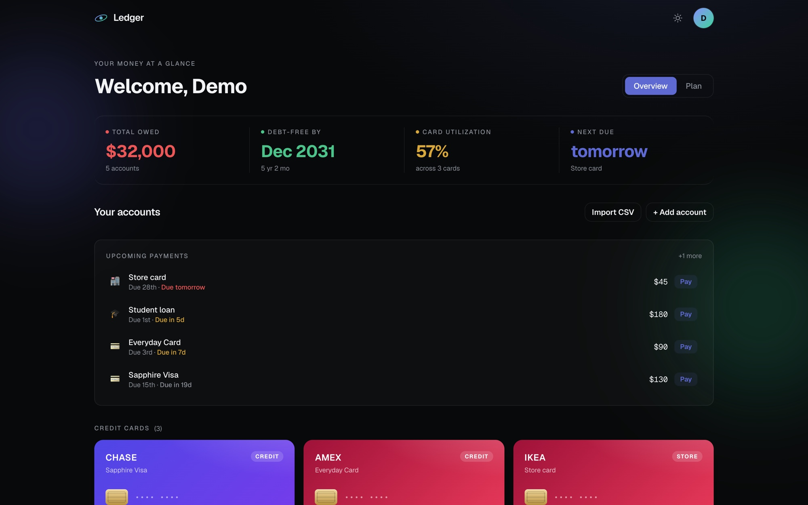
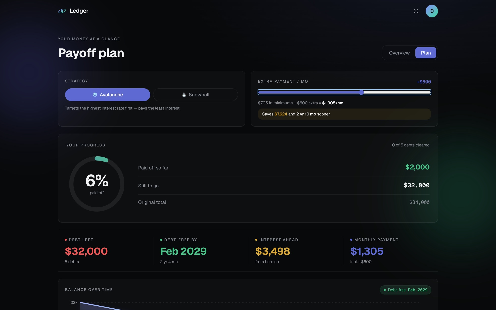
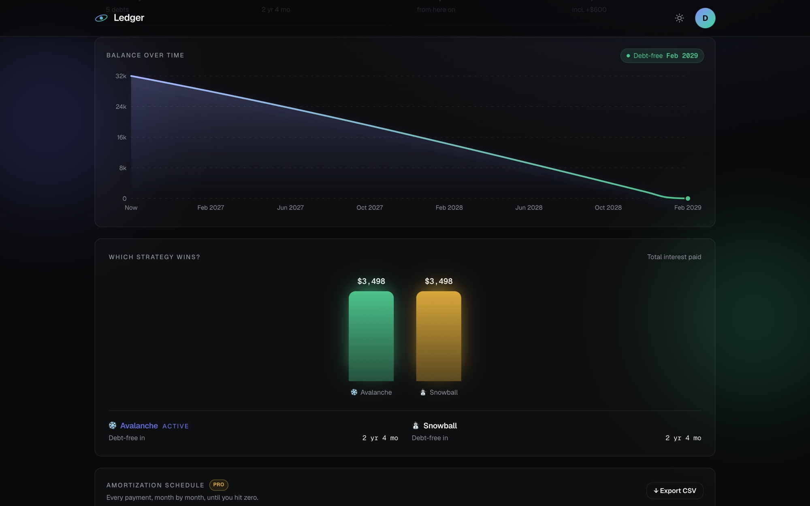
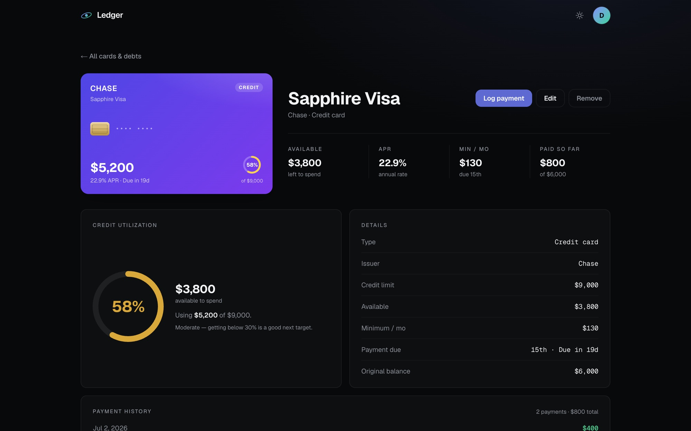
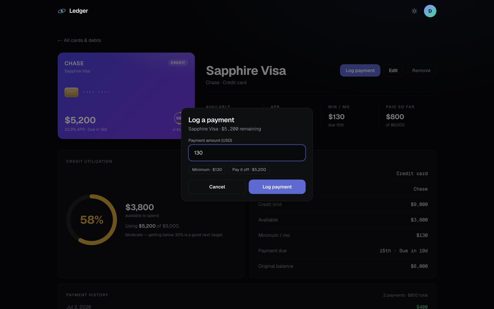
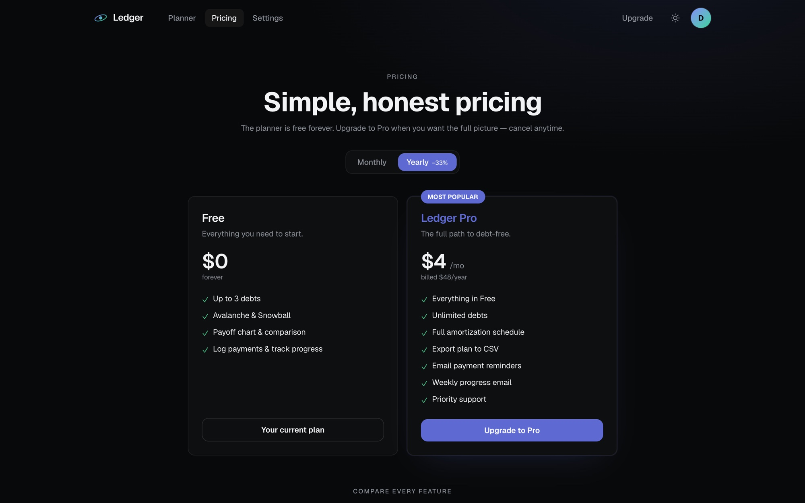
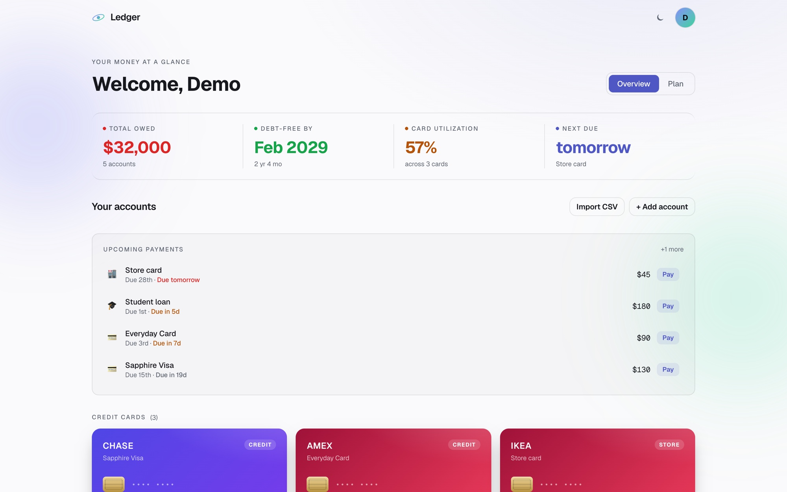
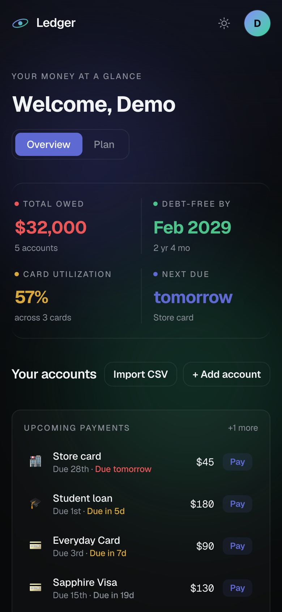
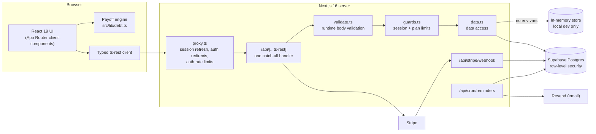

# Ledger

**A debt payoff planner that tells you which debt to pay next, when you will be
debt-free, and what an extra $100 a month is actually worth.**

You add your credit cards and loans. Ledger simulates every month of the payoff
using the avalanche or snowball strategy, shows the debt-free date and total
interest, and keeps the plan up to date as you log real payments.

[](docs/demo/ledger-demo.mp4)

**[Watch the 75-second demo (MP4)](docs/demo/ledger-demo.mp4)** · Next.js 16 ·
React 19 · TypeScript · ts-rest · Supabase · Stripe · Vitest

> Ledger is not publicly deployed. Everything shown here was recorded from a
> local production build running on the built-in demo data.

---

## Why it exists

Most people with several debts know their balances but not their plan. The
questions that matter are harder to answer by hand:

- Which balance should get the extra money this month?
- When does the last debt actually reach zero?
- How much interest does a bigger payment save, in dollars and in months?

A spreadsheet can answer these, but only if you build the amortization logic
yourself and keep it updated. Ledger does that work: it runs a month-by-month
simulation across all debts, rolls freed-up minimums into the next target, and
recalculates whenever a balance, rate or payment changes.

It is aimed at individuals paying down a mix of credit cards, store cards and
installment loans who want a clear plan more than a budgeting app.

## Features

### A payoff plan you can play with



- **Avalanche or snowball.** Avalanche targets the highest rate first (least
  interest); snowball targets the smallest balance first (quickest wins).
- **Extra payment slider.** Drag it and the debt-free date, interest ahead and
  monthly total update instantly, with the saving spelled out ("Saves $7,624
  and 2 yr 10 mo sooner").
- **Balance over time and a strategy comparison** side by side, so the
  trade-off between the two strategies is visible rather than theoretical.
- **Honest edge cases.** If the budget does not cover the minimums, or interest
  outpaces the payment, the plan says so instead of producing a date that will
  never arrive.



### Every debt in one place

- **Cards look like cards.** Credit and store cards render as card tiles with
  utilization; loans render as payoff-progress rows. Only decorative dots are
  shown in place of a card number, and no card numbers are ever stored.
- **Upcoming payments** sorted by due date, with a one-tap "Pay" action.
- **Per-debt detail pages** with utilization, details and payment history.



### Tracking real progress

- **Log payments** with quick "Minimum" and "Pay it off" amounts. Balances and
  history update immediately, and clearing a debt triggers a milestone.
- **CSV import** with per-row validation (bad rows are skipped and reported),
  and **CSV export** of the full schedule on Pro.



### Accounts, billing and reminders

- **Email and password accounts** through Supabase Auth, with email
  confirmation, password reset, data export and account deletion.
- **Free and Pro plans.** Free tracks up to 3 debts. Pro adds unlimited debts,
  the full amortization schedule, CSV export and email reminders. Stripe
  Checkout and a signed webhook keep the plan in sync.
- **Email reminders** for upcoming due dates and a weekly progress summary,
  sent by a daily scheduled job (Pro only).
- **14 currencies**, light and dark themes, and a responsive layout down to
  phone width.

| Pricing | Light theme | Phone |
| --- | --- | --- |
|  |  |  |

## Demo

The [demo video](docs/demo/ledger-demo.mp4) walks through one session: sign in,
review the dashboard, tune the plan with the extra-payment slider, switch
strategies, open a card, log a payment, and hit the free-plan limit.

To run the same flow yourself, start the app with no environment variables
(see [Getting started](#getting-started)) and sign in with the seeded demo
account `demo@ledger.app` / `password123`. That account only exists in the
local in-memory mode.

## How it works



**The payoff engine runs in the browser.** `src/lib/debt.ts` is a pure function
of debts, strategy and extra payment. Moving the slider reruns a full
simulation (up to a 100-year safety cap) without a network round trip, which is
why the plan updates as you drag.

**One typed contract for the API.** `src/lib/api/contract.ts` defines every
route with ts-rest. The client and the single catch-all route handler share it,
so a renamed field is a compile error on both sides. ts-rest's `c.type<>()` is
compile-time only, so every request body also goes through the pure validators
in `src/lib/api/validate.ts` before it reaches the database.

**Authorization lives in the database and on the server.** Supabase row-level
security scopes debts, payments and profiles to the signed-in user. Plan limits
(the 3-debt cap, reminders) are enforced in server guards and in the cron job
that sends email, not only by hiding UI.

**Every integration is optional.** Supabase, Stripe, Resend, Upstash and Sentry
are each enabled by their environment variables. With none set, the app runs
on an in-memory auth provider and fixture store, so it works on a fresh clone
with no accounts. In production that fallback refuses to serve requests unless
`ALLOW_MOCK_DATA=true`, because it is one dataset shared by every visitor.

### Engineering decisions worth calling out

- **Auth is checked twice on purpose.** `src/proxy.ts` refreshes the Supabase
  session and redirects early. The `/app` and `/settings` server layouts then
  make the authoritative check, so a proxy misconfiguration cannot expose a
  page.
- **Server state lives on `globalThis`.** Next bundles route handlers and
  Server Components into separate module graphs. A module-level `Map` for mock
  sessions meant a login in one graph was invisible to the other, so the mock
  stores hang off `globalThis` instead.
- **The cron paginates everything.** PostgREST caps a select at 1,000 rows and
  `listUsers()` returns one page by default. The reminders job walks every page
  of both, so users past the first page do not silently stop getting email.
- **Rate limits on the auth endpoints** (login, signup, reset, resend, password
  update) use a fixed window in Upstash Redis via its REST API, with an
  in-memory fallback for local development. Resend is also called over plain
  `fetch`, so neither integration adds an SDK dependency.
- **The 3D hero degrades gracefully.** The Three.js globe pauses off-screen,
  caps device pixel ratio, and falls back to an SVG globe on low-end devices
  or when the measured frame rate drops.

## Tech stack

| Area | Technology |
| --- | --- |
| Framework | Next.js 16 (App Router), React 19, TypeScript (strict) |
| Styling | Tailwind CSS v4 with CSS-variable design tokens ([docs/DESIGN.md](docs/DESIGN.md)) |
| API | ts-rest contract, served by one catch-all route handler |
| Database and auth | Supabase (Postgres with row-level security, Supabase Auth) |
| Payments | Stripe Checkout, Customer Portal and webhooks |
| Email | Resend (REST) |
| Scheduling | Vercel Cron (`vercel.json`, daily) |
| Rate limiting | Upstash Redis (REST), in-memory fallback |
| Monitoring | Sentry (enabled by DSN) |
| Charts and 3D | Recharts; Three.js via `@react-three/fiber` and `drei` |
| Testing and CI | Vitest, ESLint, `tsc`, GitHub Actions |

## Getting started

Requires Node.js 20.9 or newer (CI runs Node 22).

```bash
npm ci
npm run dev
```

Open http://localhost:6101 and sign in with `demo@ledger.app` / `password123`.
With no environment variables set, the app uses the in-memory demo data; it is
shared by all visitors and reset on every restart.

### Connecting real services

Copy `.env.example` to `.env.local` and fill in only the groups you need. An
empty group disables that integration.

| Group | Variables |
| --- | --- |
| Supabase | `NEXT_PUBLIC_SUPABASE_URL`, `NEXT_PUBLIC_SUPABASE_ANON_KEY`, `SUPABASE_SERVICE_ROLE_KEY` |
| Site URL | `NEXT_PUBLIC_SITE_URL` |
| Stripe | `STRIPE_SECRET_KEY`, `STRIPE_WEBHOOK_SECRET`, `STRIPE_PRICE_MONTHLY`, `STRIPE_PRICE_YEARLY` |
| Email | `RESEND_API_KEY`, `EMAIL_FROM`, `CRON_SECRET` |
| Rate limiting | `UPSTASH_REDIS_REST_URL`, `UPSTASH_REDIS_REST_TOKEN` |
| Sentry | `NEXT_PUBLIC_SENTRY_DSN`, `SENTRY_ORG`, `SENTRY_PROJECT`, `SENTRY_AUTH_TOKEN` |
| Demo deploys | `ALLOW_MOCK_DATA` |

**Database:** run `docs/supabase-schema.sql`, then `docs/supabase-billing.sql`
and `docs/supabase-notifications.sql`, in the Supabase SQL editor.

**Stripe (test mode):** create the product and prices with
`STRIPE_SECRET_KEY=sk_test_... node scripts/create-stripe-products.mjs`.

### Scripts

| Command | What it does |
| --- | --- |
| `npm run dev` | Development server on port 6101 |
| `npm run build` | Production build |
| `npm run start` | Serve the production build (use this to judge performance) |
| `npm run lint` | ESLint |
| `npm run typecheck` | `tsc --noEmit` |
| `npm test` | Vitest, single run (`npm run test:watch` to watch) |

`legacy-peer-deps` is set in `.npmrc` because ts-rest is pinned to
`3.53.0-rc.1`: stable 3.52 breaks type inference under TypeScript 5.9, and the
release candidate's peer ranges still list older Next.js and zod versions.

## Project structure

```
src/
  app/                    routes: landing, /app (Overview + Plan), /app/debt/[id],
                          /pricing, /settings, auth pages, guides, legal
    api/[...ts-rest]/     the single API route handler
    api/stripe/webhook/   Stripe webhook (raw body, signature check)
    api/cron/reminders/   daily reminder and weekly summary job
  components/             UI: Dashboard, CreditCardTile, LoanRow, PayoffChart, modals
  lib/
    debt.ts               payoff simulation (pure, unit tested)
    tiers.ts              Free and Pro limits, pricing, entitlement rules
    api/                  contract, client, validators, guards, data access, mock store
    auth/                 provider interface with Supabase and in-memory implementations
    supabase/, stripe/, email/
  proxy.ts                session refresh, auth redirects and rate limits
docs/                     API reference, design system, SQL schema, screenshots, demo
```

## API and data model

All endpoints are defined in `src/lib/api/contract.ts` and documented with
request and response examples in [docs/API.md](docs/API.md).

| Group | Endpoints |
| --- | --- |
| Auth | `POST /api/auth/signup`, `login`, `logout`, `resend`, `reset-request`, `update-password`, `delete-account`; `GET /api/auth/me`, `export` |
| Debts | `GET /api/debts`, `POST /api/debts`, `PATCH /api/debts/:id`, `DELETE /api/debts/:id`, `POST /api/debts/clear` |
| Payments | `GET /api/payments`, `POST /api/payments` |
| Billing | `GET /api/billing/status`, `POST /api/billing/checkout`, `POST /api/billing/portal` |
| Notifications | `GET /api/notifications`, `PATCH /api/notifications` |

Three tables back the app (`docs/supabase-*.sql`), all protected by row-level
security:

- **profiles**: one per user; display name, plan and Stripe subscription state,
  and email notification preferences. Users can read their own row but have no
  write policy, so the plan can only be changed server-side (the Stripe
  webhook uses the service role).
- **debts**: name, kind, issuer, balance, starting balance, APR, minimum
  payment, credit limit and due day.
- **payments**: amount, date, and whether the payment cleared the debt.

## Testing and quality

Seven Vitest suites (89 tests) cover the logic that is easiest to get wrong:

| Suite | Covers |
| --- | --- |
| `src/lib/debt.test.ts` | payoff simulation, strategy ordering, infeasible budgets |
| `src/lib/tiers.test.ts` | Pro entitlement and the reminder gate |
| `src/lib/importCsv.test.ts` | CSV parsing, number parsing, row validation |
| `src/lib/rateLimit.test.ts` | the fixed-window limiter |
| `src/lib/api/validate.test.ts` | request body validation |
| `src/lib/api/store.test.ts` | balance and payment rules in the demo store |
| `src/lib/api/contract.test.ts` | every HTTP method in the contract is exported by the route |

GitHub Actions (`.github/workflows/ci.yml`) runs lint, typecheck, tests and
the production build on pushes to `main` and on pull requests.

Last verified locally on 2026-10-27: lint, typecheck, all 89 tests and the
production build pass. The main flows (sign up, sign in, add, edit, pay off and
remove a debt, CSV import, plan controls, settings, pricing) were also checked
by hand in a browser, at desktop and phone widths, against the in-memory demo
data.

Not covered yet: there are no integration or end-to-end tests, and the
Supabase, Stripe, email and cron paths are not exercised by automated tests.

## Deployment

The project is set up for Vercel: `vercel.json` schedules the reminders job
daily at 13:00 UTC, and the cron route expects `Authorization: Bearer
$CRON_SECRET`. It is not publicly deployed at the moment.

A deployment needs the Supabase variables (or `ALLOW_MOCK_DATA=true` for a
throwaway demo), `NEXT_PUBLIC_SITE_URL`, and, for billing, the Stripe variables
plus a webhook pointing at `/api/stripe/webhook`.

## Status and limitations

- Feature-complete for a first release with real integrations, but not
  launched.
- Without Stripe configured, billing runs as a local simulation where Pro is
  stored in the browser, and server-side plan limits are not enforced.
- The Content Security Policy does not restrict `script-src` yet; that needs
  per-request nonces (see `next.config.ts`).
- `analytics.track()` is a stub with no provider behind it.
- Reminder timing uses server time (UTC), not each user's time zone.
- Estimates assume fixed rates and monthly compounding. Not financial advice.

## Roadmap

Planned, not built:

- Integration tests for the API routes and the reminders job, plus an
  end-to-end smoke test.
- Logging a payment as a single database transaction (today it is two writes).
- A nonce-based Content Security Policy.
- Time-zone-aware reminders.

Longer-term product thinking (markets, pricing, regionalization) is in
[docs/ROADMAP.md](docs/ROADMAP.md).

## License

No license has been chosen yet, so all rights are reserved by default. Please
get in touch before reusing the code.

Built by Usama Khaki.
